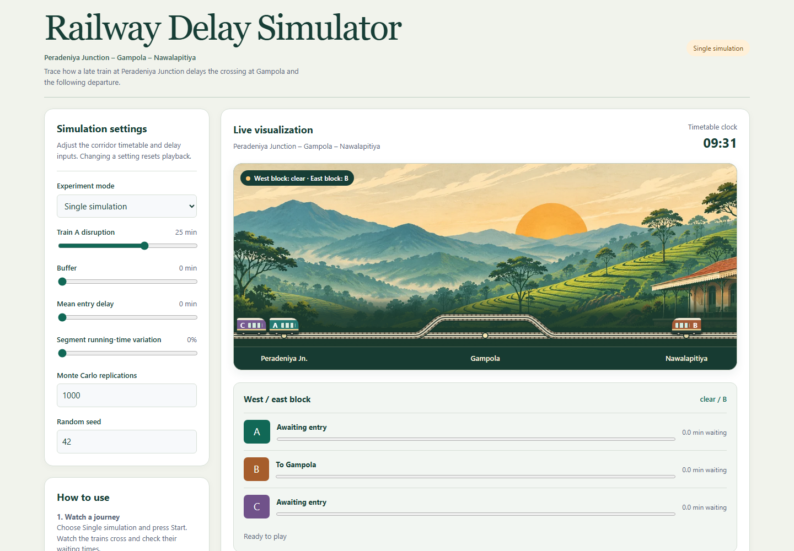
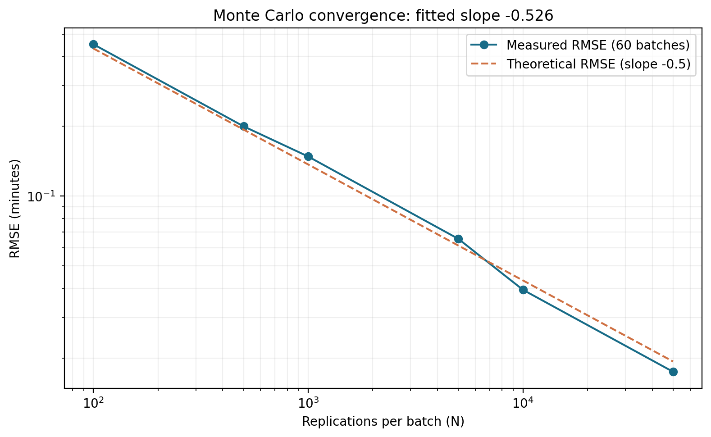

# Railway Delay Simulator

Explore how one late train delays two others on the single-track corridor between Peradeniya Junction and Nawalapitiya in Sri Lanka.

[Web demo on GitHub Pages](https://naveeth235.github.io/single-track-rail-delay-simulation/) · 

## The question

Train A leaves Peradeniya Junction late. Train B approaches from Nawalapitiya and needs to cross A at Gampola. Train C follows A from Peradeniya Junction. How much extra waiting does A cause for B and C, and how much can a timetable buffer absorb?

## Quick start

- **Browser demo.** Download and extract the repository, then open `docs/index.html` in Chrome or Edge. The animation, experiments and verification run offline.
- **Notebook.** Open the Colab badge and choose **Runtime → Run all**. The notebook includes the small timetable, installs any missing numerical packages and generates four figures.
- **Local Python.** From the repository root, run `python -m pip install -r requirements.txt`. Open `notebook/rail-delay-simulator.ipynb` in Jupyter with that Python environment and run all cells.

## Using the demo

Press **Start** with the default settings. When the journey finishes, B and C have each waited 25 extra minutes. Change **Buffer** to 15 minutes and replay. Each now waits 10 extra minutes. Switch to **Monte Carlo experiment** and set **Mean entry delay** to 5 minutes to see how the result varies across trials. [User guide](USER_GUIDE.md)

## Model and mathematics

Each track segment carries one train at a time. A train departs when it is ready and the segment is free. To isolate A’s effect, run the same timetable twice with identical random inputs, once with A’s imposed disruption and once without. Subtract the combined B and C conflict waiting in the second run from that in the first. The unit is **train-minutes**: two trains each waiting ten extra minutes contribute twenty. [Theory and equations](THEORY.md)

## Verification

The default corridor run reproduces the hand calculation of **50 train-minutes**. An independent two-service queue has a theoretical mean wait of **2.5 minutes**. Across repeated batches, increasing the replication count reduced the estimation error with a measured log–log slope of **−0.526**, close to the expected **−0.5**. [Browser checks](tests/offline-browser-results.md)

## Concepts applied

- **Discrete-event simulation** advances the notebook clock between departures and arrivals and enforces block availability.
- **Random variate generation** represents background entry delays and changes in segment running time.
- **Monte Carlo estimation** uses repeated paired trials to estimate mean extra waiting, uncertainty and the probability of a large delay.

## Results and limitations

With a 25-minute disruption, five-minute mean background entry delays and fixed running times, increasing the buffer from 0 to 15 minutes saved **18.40 train-minutes** on average (paired 95% interval **17.88–18.92**, 1,000 trials). The share of trials above 30 extra train-minutes fell from **91.7% to 27.2%**. The trade-off is that C is scheduled to finish 15 minutes later. [Buffer comparison figure](figures/corridor-buffer-effects.png)

The timetable is constructed from published segment durations. The model covers three trains, fixed priorities and one crossing location. Testing whether it predicts actual delays would require observed departure and arrival records.

## Key references

Sri Lanka Railways supplies the corridor geography. Published Podi Menike schedules for services 1005 and 1006 supply the model’s directional running times. [Sources and their uses](REFERENCES.md)

## AI assistance

AI tools assisted with code, documentation and the illustrative landscape. The notebook and dashboard include reproducible numerical checks.

## Licence and credits

The project code is released under the MIT licence. The six-movement timetable was constructed for this simulation using the credited schedules. The landscape is an illustration of the setting. [MIT licence](LICENSE) · [Timetable and data credits](data/README.md)
